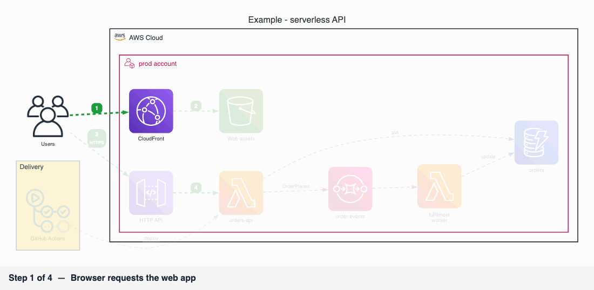
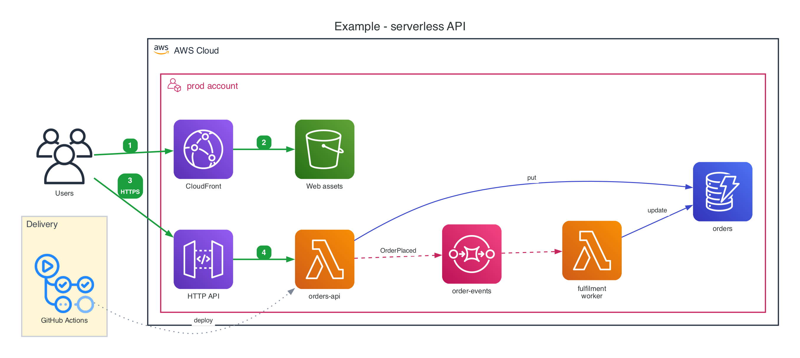
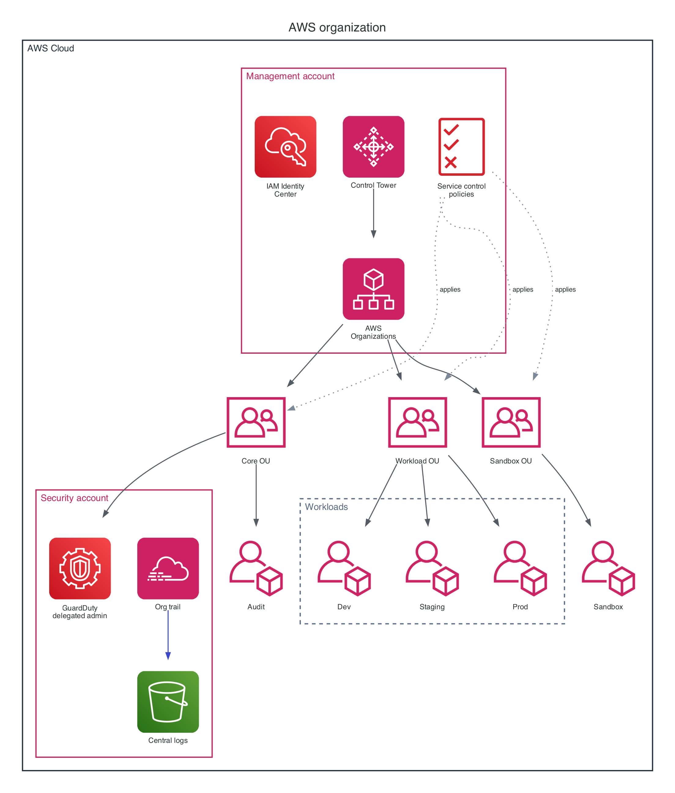
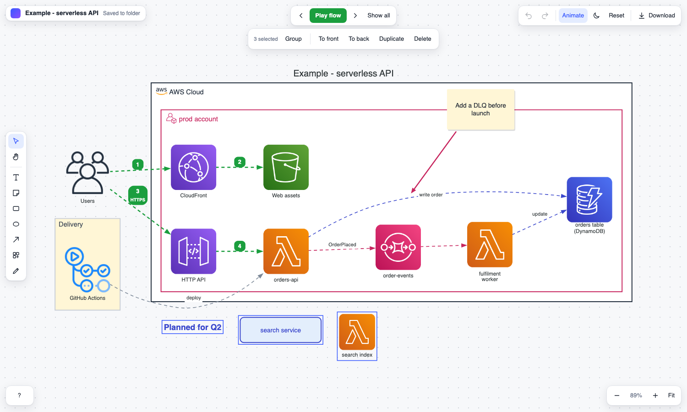
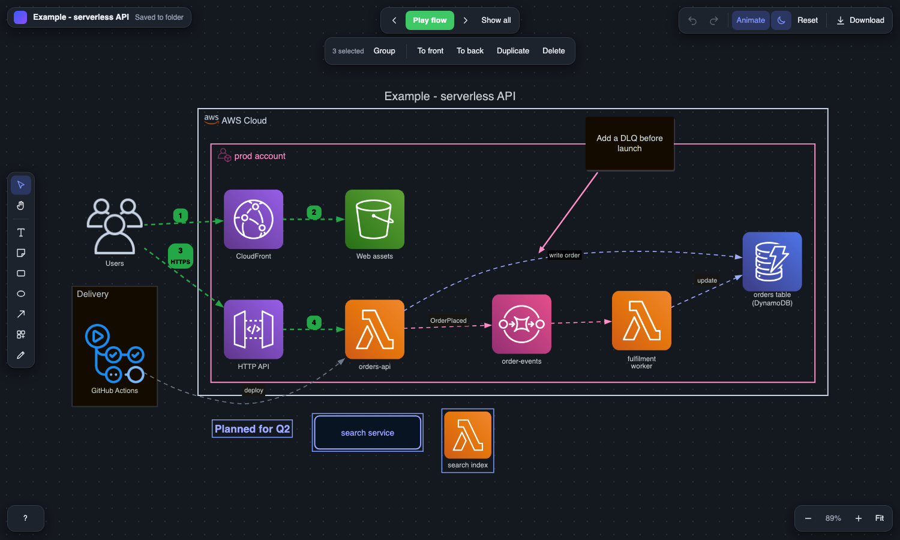

<h1 align="center">schematize</h1>

<p align="center">
  An <b>Agent Skill</b> that reads your codebase and draws its architecture<br/>
  the way teams draw it by hand in Miro, Lucidchart or draw.io.
</p>

<p align="center">
  <a href="#install"><b>Install</b></a> ·
  <a href="#use"><b>Use</b></a> ·
  <a href="#the-board"><b>The board</b></a> ·
  <a href="skills/schematize/SKILL.md"><b>Skill spec</b></a> ·
  <a href="CHANGELOG.md"><b>Changelog</b></a>
</p>

<p align="center">
  
</p>

Ask your coding agent to "draw the architecture of this codebase". The skill makes it read the
repository end to end, build an inventory where every box and arrow traces to a file, and render that
as a diagram with official AWS, Azure, GCP and Kubernetes icons, SaaS logos, nested account / VPC /
cluster boundaries and a numbered request path. Then it opens the result as an editable board: change
any label, move or resize anything, add your own notes, shapes and arrows, and your edits are saved
into the repo next to the diagram.

The GIF above was exported from the board's own Download menu.

---

## What you get

For each diagram, in `docs/architecture/` of your repo:

| File | What it is |
|---|---|
| `<name>.png` | High-resolution image for slides, docs, Miro |
| `<name>.svg` | Scalable vector with every icon embedded: one portable file |
| `<name>.html` | The editable board, a single offline file |
| `<name>.py` | The source. Edit it and re-run to regenerate all of the above |
| `<name>.board.json` | Your edits on the board, written as you make them |
| `<name>.board.png` / `.board.svg` | The diagram as you edited it |

Plus a `README.md` that explains each numbered step, lists the inventory with the file each item was
found in, and states what was inferred rather than found.

By default you get two diagrams: an **overview** (one slide, 6 to 12 components, the primary request
numbered start to finish) and a **detailed** view. Systems too large for one readable picture are
split by concern (requests, events, network, data, CI/CD) instead of being shrunk.

<p align="center"></p>

Hierarchies such as AWS Organizations render top-down:

<p align="center"></p>

## The board

A whiteboard of your diagram. Everything the skill drew is editable, and you can add to it.

<p align="center"></p>
<p align="center"></p>

**Edit what was generated**

- Double-click any label to rewrite it: component names, boundary box titles, your own text.
- Drag to move. Connectors re-route, and a boundary box carries the components inside it.
- Drag a corner to resize a component or a box. Recolour boxes and text from the bar that appears on selection.
- Select a connector to relabel or recolour it, or drag either end onto a different component to re-point it.
- Hide anything you don't want on this board. Undo or Reset brings it back.

**Add your own**

| Tool | Key | |
|---|---|---|
| Select | `V` | Move, resize, select. Drag a box around things or Shift-click to select several |
| Pan | `H` | Drag the board. Two-finger scroll and the middle mouse button pan in any tool |
| Text | `T` | Click and type |
| Sticky note | `N` | Click to drop one, or drag to size it |
| Rectangle / Ellipse | `R` / `O` | Drag to draw; double-click to label |
| Arrow | `L` | Drag from one thing to another and it stays attached as they move; drag either end later |
| Icon | `I` | Add a component: pick from this diagram's icons, or search all 2,400+ |
| Pen | `P` | Freehand |

`Del` deletes, `Cmd/Ctrl+D` duplicates, arrow keys nudge, `Cmd/Ctrl+Z` and `Shift+Cmd/Ctrl+Z` undo and redo.
`Cmd/Ctrl+G` groups the selection so it selects and moves as one, `Cmd/Ctrl+A` selects everything, and
To front / To back reorder anything, generated components included; additions can also go behind the
components.

The icon search covers the full 2,400+ library. With `--open` it reads the library on your machine,
plus any logos fetched into `diagram-icons/`. Opened as a plain file it searches an index built into the
page and loads the chosen picture from a public CDN, so that one action needs internet.

**Edits save themselves, into your repo**

Open the board with `--open` and every change is written to the diagram folder within a second:
`<name>.board.json` holds the edits, and `<name>.board.png` / `<name>.board.svg` are the picture as you
left it. Re-rendering the diagram after a code change keeps your edits: they follow a component by its
`nodeid` in the source, or failing that by its label, or failing that by its icon and position.
Commit the `.board.*` files to share the edited board with your team.

```bash
uv run docs/architecture/architecture-overview.py --open
# board: http://127.0.0.1:4747/architecture-overview.html  (edits are saved into docs/architecture)
```

`--open` starts a small background server so the page can write to disk. It listens on 127.0.0.1 only,
serves only that folder, accepts saves only from the board pages it served, and exits after 30 minutes
without use.

Opened by double-clicking the `.html` instead, the board offers **Save to folder** in its top-left
corner (Chrome, Edge and other Chromium browsers): pick the diagram folder once and edits are written
there the same way, with no server. In other browsers a plain-file board keeps edits in that browser
and says so.

If the diagram is regenerated and a saved edit no longer matches any component, the board shows an
**unmatched edits** button: attach each edit to the component it belongs to, or discard it.

**Present and export**

- **Play flow** steps through the numbered request path, dimming everything else and captioning each
  step with a sentence written from the code. `Space` plays, arrow keys step.
- **Animated flow lines** show direction on every connector; **Trace** on a component highlights only
  what it talks to.
- **Dark mode** follows your OS setting.
- **Download** PNG, SVG, or an animated GIF of the flow, matching exactly what is on the board.

## Install

Requirements on the machine running the agent:

- [Graphviz](https://graphviz.org/download/): `brew install graphviz`, `apt-get install graphviz` or `choco install graphviz`
- [uv](https://docs.astral.sh/uv/) (recommended), or Python 3.9+ with `pip install diagrams resvg-py`

### Claude Code: plugin marketplace

```
/plugin marketplace add Manukrish2504/schematize
/plugin install schematize
```

### Claude Code: manual

The skill is the `skills/schematize/` folder. Copy it to `~/.claude/skills/` to use it everywhere, or to
`.claude/skills/` inside a repository to share it with your team:

```bash
git clone https://github.com/Manukrish2504/schematize /tmp/schematize
cp -r /tmp/schematize/skills/schematize ~/.claude/skills/schematize
```

### Other agents

The skill is a standard `SKILL.md` folder with two helper scripts, so it can be copied into any agent
that loads skills from a directory (for example `.agents/skills/schematize`). It has only been tested
with Claude Code.

## Use

```
Draw the architecture of this codebase.
```

```
/schematize overview only, focus on the AWS networking
```

```
Schematize the payments service and show how a checkout request flows through it.
```

To change a diagram afterwards, edit its `.py` file (or ask the agent to) and re-run it:

```bash
uv run docs/architecture/architecture-overview.py          # regenerate, keeping board edits
uv run docs/architecture/architecture-overview.py --open   # regenerate and open the editable board
```

### When not to use it

| You want | Use instead |
|---|---|
| A sequence diagram or ER diagram in a PR description | Inline Mermaid |
| A quick sketch that lives in markdown | Inline Mermaid |
| Pixel-exact manual placement of every box | A drawing tool; start from the SVG this exports |

## How it works

1. **Read.** Docs and agent memory, infrastructure as code (Terraform, CloudFormation, CDK, Pulumi,
   Bicep, Kubernetes, Helm, Compose, serverless and platform configs), every deployable unit, SDK
   imports and connection config, CI/CD.
2. **Inventory.** Component, kind, boundary, what it talks to, and the `file:line` that proves it.
   Nothing is drawn because "systems like this usually have one".
3. **Pick icons.** Bundled official icon first, fetched brand logo second, generic icon last.
4. **Render.** One short Python script per diagram on top of a shared style module.
5. **Inspect.** The agent opens its own PNG, checks it against a list of layout defects, and fixes
   them before handing over.
6. **Launch.** The overview board opens in your browser, ready to edit.

| Path | Purpose |
|---|---|
| `skills/schematize/SKILL.md` | The workflow and layout rules the agent follows |
| `skills/schematize/assets/schematize_style.py` | House style, SVG post-processing and the board's save server; copied next to your diagrams |
| `skills/schematize/assets/schematize_board.html` | The board itself: editor, flow player, exports. No dependencies |
| `skills/schematize/assets/example.py` | A 40-line diagram script that new ones are modelled on |
| `skills/schematize/scripts/icons.py` | `search` the bundled icons, `fetch` full-colour brand logos |
| `tests/test_skill.py` | Renders the example and checks every output |
| `evals/` | Prompts and graders for the skill's behaviour |

### Diagram source at a glance

```python
from schematize_style import *
from diagrams.aws.compute import Lambda
from diagrams.aws.network import APIGateway
from diagrams.aws.database import Dynamodb
from diagrams.onprem.client import Users

with diagram("Orders API", "architecture-overview"):
    users = Users("Users", nodeid="users")
    with group("AWS Cloud", "cloud", icon="diagram-icons/aws.png"):
        api = APIGateway("HTTP API", nodeid="http-api")
        fn = Lambda("orders-api", nodeid="orders-api")
        table = Dynamodb("orders", nodeid="orders-table")

    users >> step("HTTPS", "The app calls the orders API") >> api
    api >> step(desc="API Gateway invokes the handler") >> fn
    fn >> data("put") >> table
```

| Helper | Draws |
|---|---|
| `group(label, kind, icon=, fill=)` | Boundary box: `cloud`, `account`, `region`, `vpc`, `public`, `private`, `cluster`, `security`, `external`, `group`, `panel` |
| `step(note, desc)` | Thick green arrow with an auto-incrementing number; `desc` is the caption used by Play flow and the GIF |
| `sync` / `event` / `data` / `ops` | Synchronous call, asynchronous message, datastore access, deploy or monitoring link |

Change colours, fonts or box styles for your organisation in `schematize_style.py`; every diagram in the
folder picks them up on the next run.

## Icons

- **Bundled**: 2,400+ icons from [mingrammer/diagrams](https://github.com/mingrammer/diagrams), covering
  AWS, Azure, GCP, Kubernetes, OCI, Alibaba Cloud, DigitalOcean, IBM, Elastic, Firebase, on-prem open
  source, SaaS and programming languages.
- **Fetched on demand**: full-colour brand marks from [gilbarbara/logos](https://github.com/gilbarbara/logos)
  through the Iconify API, falling back to [Simple Icons](https://simpleicons.org). Only the brand name
  is sent. Fetched logos are saved into `diagram-icons/` next to the diagrams.

```bash
uv run skills/schematize/scripts/icons.py search "api gateway" postgres kafka
uv run skills/schematize/scripts/icons.py fetch aws vercel supabase -o docs/architecture/diagram-icons
```

## Limitations

- Layout is automatic (Graphviz). Connectors are curves, not the right-angle lines of hand-drawn AWS
  diagrams; right-angle routing is available for diagrams without edge labels, such as organisation trees.
- Board edits live in `<name>.board.json` and the `.board.png` / `.board.svg` pictures. They do not
  rewrite the `.py` source or the generated `<name>.png`.
- A connector generated by the skill can be re-pointed between existing components, but new
  connectors you add are plain arrows: they stick to what they join, without step numbers or flow playback.
- Saving into the folder without `--open` needs a Chromium browser and one folder pick per browser
  session; Firefox and Safari keep plain-file edits in the browser.
- Without `--open`, the icon picker loads library pictures from a public CDN and cannot see logos in
  `diagram-icons/`.
- GIFs use a 256-colour palette, so gradients in icons show slight banding.
- The diagram is as accurate as the repository. Resources created by hand in a cloud console, and
  anything in another repository, will not appear; the generated README lists what could not be determined.

## Development

```bash
uv run tests/test_skill.py
```

Needs Graphviz and Node.js. The suite checks the skill's frontmatter and file references, the plugin
manifests, icon search, a full render of the example (PNG, self-contained SVG with no local paths, board
with no external requests), the board script's syntax, tools and controls, the GIF encoder (run under
Node on synthetic frames and decoded with Pillow to compare every pixel), that board edits survive a
re-render, and that the board server saves into the folder, serves icon search, and refuses requests
without its token, path traversal and directory listing. CI runs the same script on every push and pull request.

Editing in a real browser (drawing, dragging, resizing, text editing, multi-select and grouping,
re-pointing connectors, sticky arrows, the icon picker with and without the server, layer order, rename
matching and manual re-attachment, undo, saving through the server and straight into a folder, the
three downloads, dark mode) was exercised in headless Chrome during development with scripted
pointer events and is not yet part of the automated suite. See [`evals/`](evals/)
for behavioural checks of the skill itself.

## Credits and trademarks

Rendering is [mingrammer/diagrams](https://github.com/mingrammer/diagrams) on
[Graphviz](https://graphviz.org). The idea of a skill that turns a codebase into a diagram you can play
through comes from [konraddzbik/architecture-diagram-skill](https://github.com/konraddzbik/architecture-diagram-skill).

Vendor icons and logos are trademarks of their respective owners and are used to identify their
products. Follow each vendor's brand guidelines when you publish diagrams.

## License

[MIT](LICENSE)
